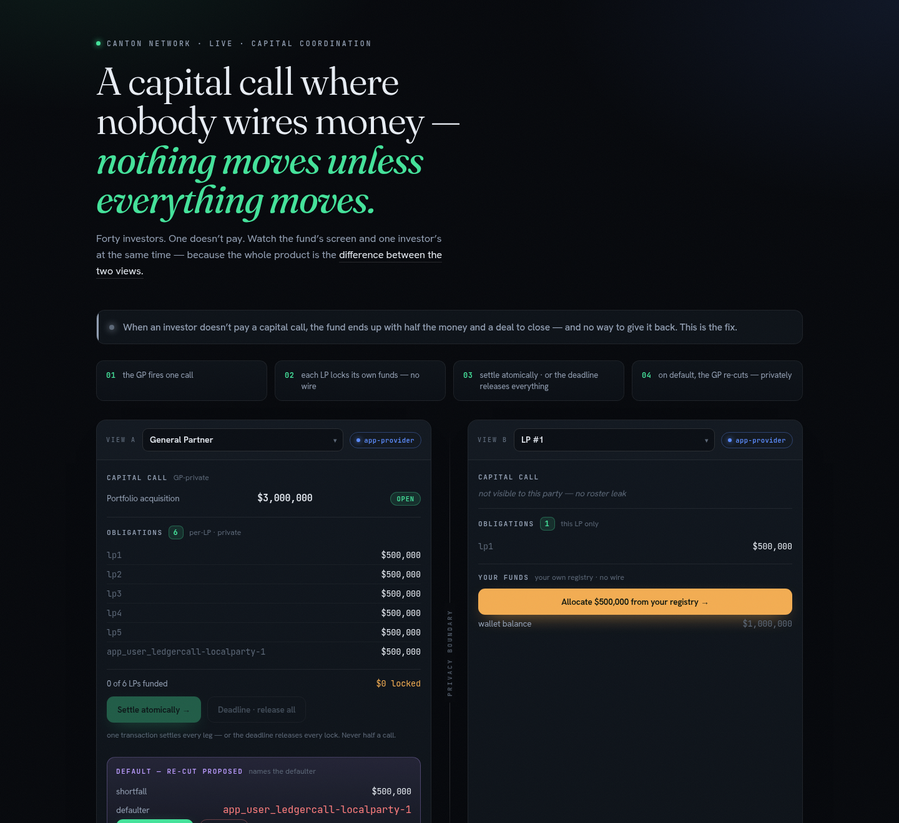
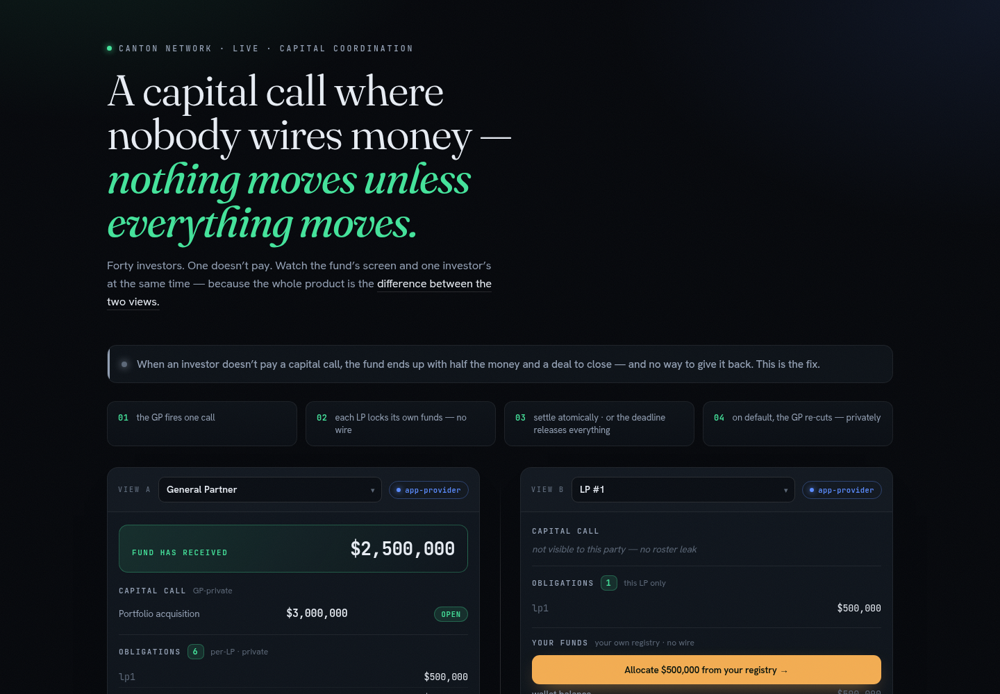

# LEDGERCALL viewports

A guided, two-pane demo over the **live** Canton JSON Ledger API — because every claim
this product makes is a claim about the *difference between two views*. You watch two
screens at once (the fund's and one investor's) and drive the whole capital-call story
with real on-ledger actions.



Every button is a **real Daml choice** submitted to the ledger (nothing is faked):

- **LP — Allocate** (`Cash_Allocate`): the LP locks its share in its own registry, a real
  token-standard `Allocation`. No wire, non-custodial. The pane shows "🔒 locked".
- **GP — Settle call, atomically** (`Allocation_ExecuteTransfer` × N in ONE `submitMulti`):
  every leg settles in a single transaction, and the GP pane shows
  *"The fund has received $X,XXX,XXX"*.
  
- **GP — Deadline passed, release all** (`Allocation_Withdraw`): every lock returns to its
  owner — *not one cent moved*.
- **GP — Approve / Decline re-cut** (`ApproveRecut` / `DeclineRecut`): the discretionary
  dilution decision; on Approve, each non-defaulting LP's new number appears — visible only
  to it.

The isolated LP is hosted on a **different participant** (`app-user`); its pane shows one
obligation and "call not visible (no roster leak)". Both panes are dropdowns over all
parties, so you can put any view beside any other and watch the boundary hold.

## Run

LocalNet must be up and seeded first (`scripts/setup-localnet.sh`, `scripts/seed-localnet.sh`,
`scripts/gen-frontend-config.sh` — see the top-level README).

```bash
cd frontend
npm install
npm run dev     # http://localhost:5173
```

The Vite dev server proxies `/ap` → app-provider JSON API (3975) and `/au` → app-user
(2975), so the browser talks same-origin (no CORS). Party IDs + the reader token are read
at runtime from `public/demo-config.json` (regenerate after re-seeding with
`scripts/gen-frontend-config.sh`).

> Each viewport queries the Ledger API filtered to that party, so the browser shows
> exactly what that party is entitled to see — the same boundary proven in SQL in
> `docs/evidence/privacy-proof.md`.
